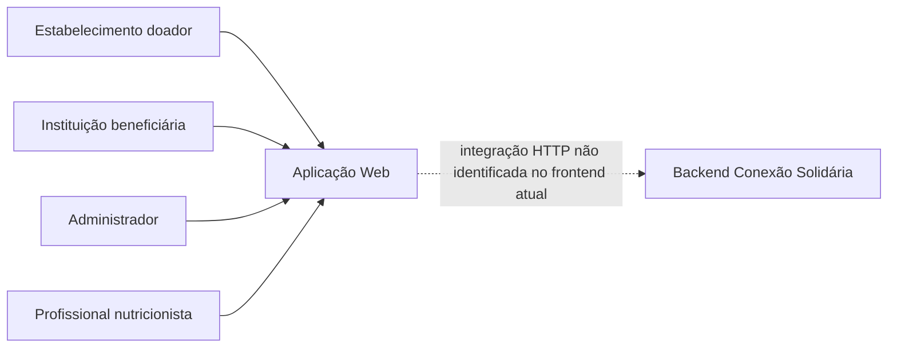
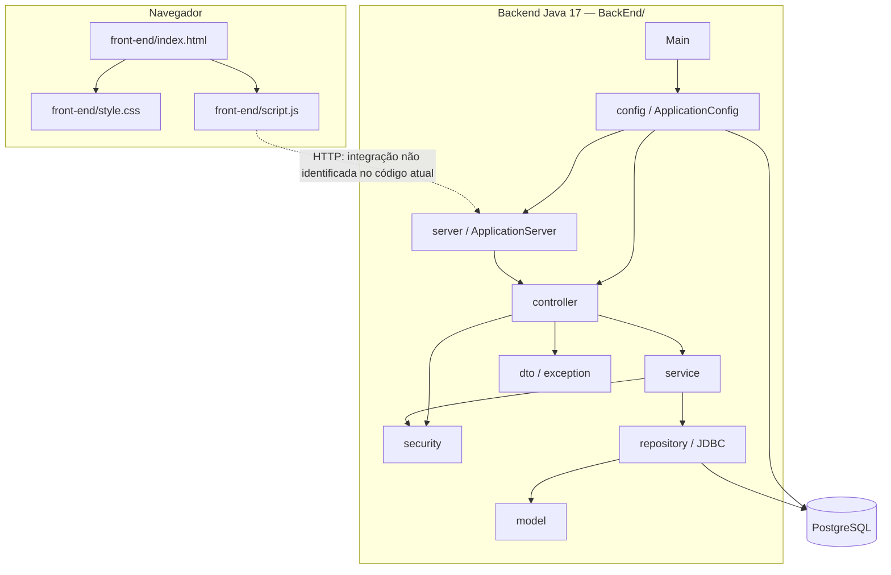
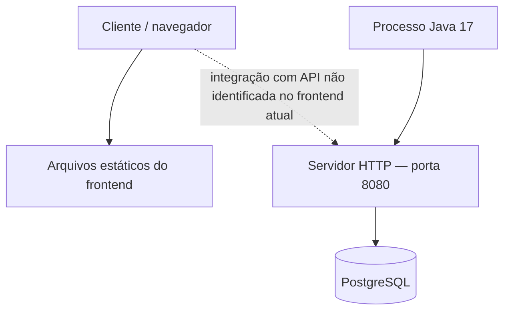

# Arquitetura de software

> **Artefato central da Sprint 6.** A arquitetura descreve a organização global da aplicação, as responsabilidades das partes e suas interações.

## 1. Visão geral

**Estilo arquitetural:** Cliente-servidor, com frontend web estático e backend Java organizado em camadas, executado como um monólito modular.

**Justificativa:** A separação entre frontend e backend organiza a interface e as regras de negócio em partes distintas. No backend, os pacotes `server`, `controller`, `service`, `repository`, `model`, `security`, `dto`, `exception` e `config` separam responsabilidades e favorecem a manutenibilidade (RNF-10) e a rastreabilidade (RNF-11). A camada de serviços concentra casos de uso, enquanto os componentes de segurança apoiam autenticação e autorização (RNF-01 e RNF-02). O backend conecta-se ao PostgreSQL por JDBC, executa migrações com Liquibase e persiste os modelos ativos em uma tabela de compatibilidade. O frontend ainda não apresenta integração HTTP identificada com a API.

## 2. Diagrama de contexto

**Descrição:** Estabelecimentos doadores, instituições beneficiárias, administradores e profissionais nutricionistas representam os perfis que utilizam o Conexão Solidária. Eles acessam a aplicação web por meio de um navegador. O backend disponibiliza rotas HTTP e reúne controllers, serviços, repositórios e componentes de segurança. A seta tracejada representa a separação prevista entre cliente e servidor; na versão do frontend analisada, não foram identificadas chamadas HTTP ao backend em `front-end/script.js`. As interações e os dados existentes no frontend são manipulados localmente.

## 3. Diagrama de contêineres/componentes

> O frontend permanece sem chamadas HTTP identificadas para a API. Os construtores sem banco dos repositórios continuam disponíveis para os testes unitários.

## 4. Componentes e responsabilidades

| Componente | Responsabilidade | Tecnologia | Diretório/serviço real | Comunicação |
|---|---|---|---|---|
| Frontend | Apresentar telas, navegação, formulários e interações do usuário. | HTML, CSS e JavaScript | `front-end/index.html`, `front-end/style.css`, `front-end/script.js` | Executado no navegador; na versão analisada, manipula dados e interações localmente. |
| Inicialização | Criar a configuração da aplicação e iniciar o servidor na porta 8080. | Java 17 | `BackEnd/src/main/java/conexaosolidaria/Main.java` | Chama `ApplicationConfig` e inicia `ApplicationServer`. |
| Configuração | Instanciar repositórios, serviços, componentes de segurança e controllers; registrar rotas. | Java 17 | `BackEnd/src/main/java/conexaosolidaria/config/ApplicationConfig.java` | Injeta dependências por construtores e registra handlers no servidor HTTP. |
| Servidor HTTP | Receber requisições, localizar rotas, aplicar CORS e converter erros em respostas HTTP/JSON. | `com.sun.net.httpserver.HttpServer` | `BackEnd/src/main/java/conexaosolidaria/server/` | Encaminha requisições aos handlers registrados. |
| Controllers | Interpretar requisições HTTP, chamar serviços e produzir respostas da API. | Java 17 | `BackEnd/src/main/java/conexaosolidaria/controller/` | Recebem requisições por meio das rotas e acionam os serviços. |
| Serviços | Implementar casos de uso e regras de negócio de usuários, autenticação, ofertas, demandas, solicitações e cadastros. | Java 17 | `BackEnd/src/main/java/conexaosolidaria/service/` | Recebem dependências por construtor e consultam ou alteram repositórios. |
| Segurança | Apoiar autenticação, geração e validação de tokens, hash de senhas e autorização. | Java 17 | `BackEnd/src/main/java/conexaosolidaria/security/` | Utilizada pelos controllers e serviços que precisam autenticar ou autorizar operações. |
| Repositórios | Armazenar e consultar os dados utilizados pelos serviços. | Java 17, JDBC e PostgreSQL | `BackEnd/src/main/java/conexaosolidaria/repository/` | No servidor, carregam e persistem registros em `backend_entity_store`; os construtores sem banco são usados nos testes unitários. |
| Modelos | Representar entidades e estados do domínio. | Java 17 | `BackEnd/src/main/java/conexaosolidaria/model/` | Utilizados por serviços e repositórios. |
| DTOs e exceções | Transportar dados específicos e padronizar erros da API. | Java 17 | `BackEnd/src/main/java/conexaosolidaria/dto/` e `BackEnd/src/main/java/conexaosolidaria/exception/` | Utilizados pelos controllers e pelo servidor HTTP. |
| Configuração de banco e migrações | Configurar a conexão PostgreSQL e aplicar migrações antes de iniciar o servidor. | JDBC, properties e Liquibase | `BackEnd/src/main/java/conexaosolidaria/repository/DatabaseStore.java` e `BackEnd/src/main/resources/db/changelog/` | Lê `DB_URL`, `DB_USERNAME` e `DB_PASSWORD` (ou propriedades padrão) e falha na inicialização se a conexão/migração falhar. |

## 5. Decisões arquiteturais

### DA-01 — Organização do backend em camadas

- **Contexto:** O backend reúne responsabilidades de tratamento HTTP, regras de negócio, acesso aos dados, segurança e representação do domínio.
- **Decisão:** Organizar o código em pacotes separados (`server`, `controller`, `service`, `repository`, `model`, `security`, `dto`, `exception` e `config`), mantendo a aplicação em um único processo Java.
- **Requisitos/atributos de qualidade:** `RNF-10` (manutenibilidade), `RNF-11` (rastreabilidade) e `RNF-02` (controle de acesso).
- **Consequências e trade-offs:** A separação facilita a localização das responsabilidades e a manutenção. Em contrapartida, exige contratos claros entre as camadas e atenção para que as regras de negócio não fiquem distribuídas indevidamente entre controllers e serviços.
- **Evidência no repositório:** `BackEnd/src/main/java/conexaosolidaria/`, especialmente os diretórios `server/`, `controller/`, `service/`, `repository/`, `model/` e `security/`; `docs/projeto/decisoes-de-projeto.md`.

### DA-02 — Composição manual das dependências

- **Contexto:** Os componentes do backend precisam receber repositórios, serviços e mecanismos de segurança para executar seus casos de uso.
- **Decisão:** Utilizar `ApplicationConfig` como raiz de composição, instanciando explicitamente os objetos e injetando suas dependências por construtores.
- **Requisitos/atributos de qualidade:** `RNF-10` (manutenibilidade) e `RNF-11` (rastreabilidade).
- **Consequências e trade-offs:** A configuração deixa explícitas as relações entre os componentes e dispensa um framework de injeção de dependências. Por outro lado, concentra instanciações e registros de rotas em um ponto que pode crescer conforme a aplicação evoluir.
- **Evidência no repositório:** `BackEnd/src/main/java/conexaosolidaria/config/ApplicationConfig.java`.

### DA-03 — Servidor HTTP nativo e aplicação Java monolítica

- **Contexto:** O backend precisa disponibilizar rotas HTTP para as funcionalidades da aplicação.
- **Decisão:** Utilizar `com.sun.net.httpserver.HttpServer`, com rotas registradas manualmente e tratamento centralizado de respostas e exceções, executando a aplicação em um único processo Java.
- **Requisitos/atributos de qualidade:** `RNF-05` (desempenho, a validar por testes), `RNF-08` (compatibilidade) e `RNF-10` (manutenibilidade).
- **Consequências e trade-offs:** A solução reduz dependências externas e mantém o servidor simples. Em contrapartida, roteamento, tratamento HTTP, CORS e outros recursos precisam ser mantidos pela própria equipe.
- **Evidência no repositório:** `BackEnd/src/main/java/conexaosolidaria/server/ApplicationServer.java`, `RouteHandler.java`, `JsonResponse.java`, `Main.java` e `BackEnd/pom.xml`.

### DA-04 — Persistência PostgreSQL dos modelos ativos

- **Contexto:** Os serviços precisam preservar usuários, ofertas, solicitações, demandas e demais entidades após a reinicialização. O schema Liquibase preexistente não corresponde aos modelos ativos do backend.
- **Decisão:** Usar JDBC e Liquibase; os repositórios do servidor carregam e salvam objetos serializados na tabela PostgreSQL `backend_entity_store`. Os construtores sem banco permanecem para testes unitários.
- **Requisitos/atributos de qualidade:** `RNF-04` (integridade das quantidades) e `RNF-11` (rastreabilidade).
- **Consequências e trade-offs:** Os registros deixam de ser perdidos ao reiniciar o processo, mas a tabela de compatibilidade não é normalizada nem expõe os campos das entidades para consultas SQL. As credenciais do PostgreSQL devem ser configuradas no ambiente; neste workspace, a senha anteriormente declarada foi rejeitada pelo servidor local, por isso a migração não foi validada nele.
- **Evidência no repositório:** `BackEnd/src/main/java/conexaosolidaria/repository/DatabaseStore.java`, repositórios, `BackEnd/src/main/resources/db/changelog/changes/backend_entity_store.xml` e `BackEnd/src/main/resources/application.properties`.

### DA-05 — Frontend web estático com estado local

- **Contexto:** A aplicação disponibiliza uma interface web com fluxos de ofertas, solicitações e demandas.
- **Decisão:** O frontend existente é composto por arquivos estáticos HTML, CSS e JavaScript, com dados e operações manipulados no próprio `script.js`.
- **Requisitos/atributos de qualidade:** `RNF-06` (usabilidade), `RNF-07` (acessibilidade), `RNF-08` (compatibilidade) e `RNF-09` (responsividade).
- **Consequências e trade-offs:** A interface pode ser executada sem um processo de build de framework frontend. Entretanto, enquanto não houver chamadas à API, os dados e ações do navegador não estarão integrados aos dados gerenciados pelo backend.
- **Evidência no repositório:** `front-end/index.html`, `front-end/style.css` e `front-end/script.js`; não foram localizadas chamadas `fetch`, `XMLHttpRequest` ou referências ao endereço HTTP do backend no arquivo `script.js` analisado.

## 6. Implantação e execução

**Ambientes:**

| Ambiente | Endereço ou comando | Finalidade |
|---|---|---|
| Local | Na pasta `BackEnd/`: `mvn compile exec:java` | Desenvolvimento e testes do backend. Requer Maven e Java 17; o servidor é iniciado na porta 8080 (`http://localhost:8080`). |
| Local — frontend | Abrir `front-end/index.html` no navegador ou servir a pasta `front-end/` por um servidor HTTP estático. | Visualizar e testar as interações locais da interface. |
| Publicado | Não informado no README consultado; o endereço da aplicação consta como “em andamento”. | Não há URL pública confirmada para demonstração nesta versão. |

## 7. Riscos arquiteturais

| Risco | Probabilidade | Impacto | Mitigação | Issue |
|---|---|---|---|---|
| Tabela de compatibilidade armazena objetos binários e não permite consultar os campos do domínio diretamente em SQL. | Média | Média | Migrar gradualmente para tabelas relacionais alinhadas aos modelos ativos. | A abrir; relacionado à arquitetura `#28`. |
| Frontend sem integração efetiva com a API do backend na versão analisada. | Alta | Alta | Implementar chamadas HTTP no frontend, tratar respostas e erros e validar os fluxos ponta a ponta. | A abrir; relacionado à arquitetura `#28`. |
| Credenciais configuradas podem não corresponder às do PostgreSQL do ambiente. | Média | Alta | Definir `DB_URL`, `DB_USERNAME` e `DB_PASSWORD`; validar a migração e a persistência com o banco do ambiente. | A abrir; relacionado à arquitetura `#28`. |
| Concentração da montagem de dependências e do registro de rotas em `ApplicationConfig`. | Média | Média | Avaliar a divisão da configuração por módulos ou grupos de funcionalidades, mantendo explícita a composição. | A abrir; relacionado à arquitetura `#28`. |
| Regras de autorização distribuídas entre controllers e serviços. | Média | Alta | Concluir a migração das verificações para a camada de serviços, conforme decisão registrada no documento de decisões do projeto. | Acompanhar decisão registrada em `docs/projeto/decisoes-de-projeto.md`. |
| Uso de CORS com origem `*` no servidor HTTP. | Média | Alta | Restringir as origens permitidas aos domínios utilizados nos ambientes de execução e validar as requisições autorizadas. | A abrir; relacionado à arquitetura `#28`. |
| Ausência de endereço de implantação publicado e de evidência de ambiente de produção. | Alta | Média | Definir ambiente de publicação, registrar endereço e procedimento de implantação e atualizar o README. | A abrir; relacionado à arquitetura `#28`. |

## 8. Correspondência arquitetura × código

| Elemento do diagrama | Evidência no código/configuração |
|---|---|
| Interface web | `front-end/index.html`, `front-end/style.css` e `front-end/script.js`. |
| Inicialização do backend | `BackEnd/src/main/java/conexaosolidaria/Main.java`. |
| Raiz de composição | `BackEnd/src/main/java/conexaosolidaria/config/ApplicationConfig.java`. |
| Servidor e roteamento HTTP | `BackEnd/src/main/java/conexaosolidaria/server/ApplicationServer.java`, `RouteHandler.java` e `JsonResponse.java`. |
| Controllers e endpoints | `BackEnd/src/main/java/conexaosolidaria/controller/`. |
| Regras e casos de uso | `BackEnd/src/main/java/conexaosolidaria/service/`. |
| Autenticação e autorização | `BackEnd/src/main/java/conexaosolidaria/security/`. |
| Repositórios e armazenamento JDBC | `BackEnd/src/main/java/conexaosolidaria/repository/`. |
| Entidades e estados do domínio | `BackEnd/src/main/java/conexaosolidaria/model/`. |
| Objetos de transferência e exceções | `BackEnd/src/main/java/conexaosolidaria/dto/` e `BackEnd/src/main/java/conexaosolidaria/exception/`. |
| Configuração de build e versão Java | `BackEnd/pom.xml`. |
| Configuração PostgreSQL | `BackEnd/src/main/resources/application.properties` e variáveis `DB_URL`, `DB_USERNAME` e `DB_PASSWORD`. |
| Migrações Liquibase | `BackEnd/src/main/resources/db/changelog/`; aplicadas ao iniciar o servidor, pendentes de validação neste ambiente por credenciais rejeitadas. |
| Requisitos funcionais e não funcionais | `docs/requisitos/requisitos.md`. |
| Decisões locais de projeto | `docs/projeto/decisoes-de-projeto.md`. |
