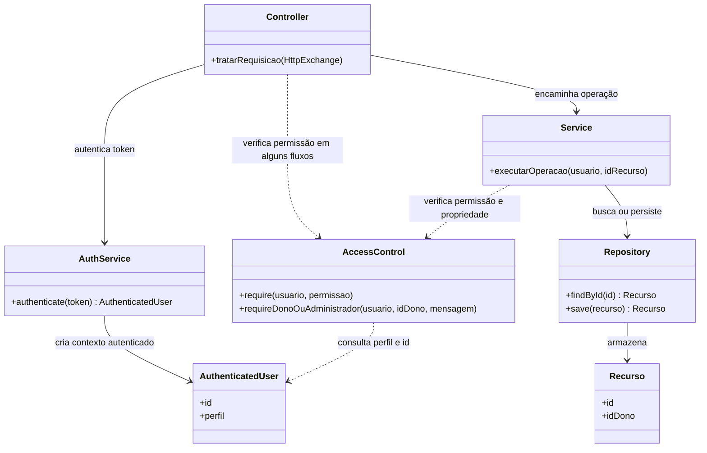

# Levantamento de problemas técnicos — Conexão Solidária

> **Finalidade:** registrar os problemas técnicos, riscos e inconsistências identificados no projeto Conexão Solidária, facilitando a priorização de correções e o planejamento das próximas sprints.
>
> **Observação:** os achados foram organizados a partir do levantamento realizado com o Codex. Os problemas devem ser conferidos no repositório antes de serem considerados definitivamente validados.

## 1. Resumo executivo

O levantamento inicial identificou 14 problemas ou riscos: 1 crítico, 2 altos, 10 médios e 1 baixo.

| Categoria | Quantidade informada |
|---|---:|
| Segurança | 5 |
| Compilação | 1 |
| Regra de negócio | 1 |
| Validação | 1 |
| Requisitos | 1 |
| Front-end | 1 |
| Documentação e rastreabilidade | 1 |
| Arquitetura | 1 |
| Integridade de dados | 1 |
| Concorrência | 1 |
| **Total** | **14** |

O PROB-001 foi posteriormente resolvido, conforme informado pela equipe, após a execução bem-sucedida de `mvn clean test`.

## 2. Problemas identificados

### PROB-001 — Pacotes incompatíveis impediam a compilação

- **Categoria:** Compilação
- **Severidade original:** Alta
- **Status:** Resolvido
- **Evidência:** a equipe informou que executou `mvn clean test` com sucesso (`BUILD SUCCESS`).
- **Descrição:** declarações de pacotes incompatíveis com a estrutura do projeto impediam a resolução de classes e símbolos durante a compilação.
- **Correção realizada:** ajuste das declarações de pacotes e referências necessárias, conforme informado pela equipe.
- **Resultado:** compilação e testes concluídos com sucesso.
- **Próximo passo:** registrar o commit da correção e atualizar a Issue #68 / PRJ-03, caso corresponda ao escopo dessa Issue.

### PROB-002 — Cadastro público permite criar administradores

- **Categoria:** Segurança e autorização
- **Severidade:** Crítica
- **Status:** Pendente de validação e correção
- **Localização informada:** `UsuarioController.java`, `UsuarioService.java` e `PerfilUsuario.java`.
- **Evidência:** o endpoint `POST /usuarios` aceita o perfil informado na requisição, incluindo `ADMINISTRADOR`, sem uma verificação de autorização para criação desse perfil.
- **Descrição:** o cadastro público pode permitir que uma pessoa crie uma conta administrativa.
- **Impacto:** possível elevação indevida de privilégios.
- **Recomendação:** impedir a criação de perfis privilegiados pelo endpoint público e definir um processo protegido para provisionar administradores.
- **Relação com itens anteriores:** RF-05, RF-06, RNF-02 e Issue #18, conforme o levantamento.

### PROB-003 — Instituição pode ser habilitada sem verificar nutricionista

- **Categoria:** Regra de negócio e autorização
- **Severidade:** Alta
- **Status:** Pendente de validação e correção
- **Localização informada:** `InstituicaoService.java`, `SolicitacaoOfertaService.java` e `RequisitosNovosServiceTest.java`.
- **Evidência:** o fluxo de habilitação não verifica o vínculo com nutricionista; o fluxo de solicitação também precisa verificar se a instituição está habilitada.
- **Descrição:** uma instituição sem responsável técnico pode ser habilitada ou solicitar ofertas em desacordo com as regras de negócio.
- **Impacto:** operações podem ser realizadas por instituições que não atendem aos critérios previstos.
- **Recomendação:** verificar o vínculo com nutricionista antes da habilitação e validar a situação da instituição ao solicitar ofertas.
- **Relação com itens anteriores:** RN-01, RN-02, RF-03, RF-04, RF-10 e Issue #15, conforme o levantamento.

### PROB-004 — Valores não finitos passam pela validação numérica

- **Categoria:** Validação
- **Severidade:** Média
- **Status:** Pendente de validação e correção
- **Localização informada:** `RequestUtils.java`, `OfertaService.java` e `DemandaService.java`.
- **Evidência:** a validação de valores convertidos para `double` rejeita valores menores ou iguais a zero, mas essa condição não rejeita necessariamente `NaN` e infinito.
- **Descrição:** entradas numéricas não finitas podem ser aceitas.
- **Impacto:** quantidades incoerentes ou problemas na serialização de respostas.
- **Recomendação:** rejeitar explicitamente valores não finitos e validar quantidades positivas e finitas.
- **Relação com itens anteriores:** RN-03 e RNF-04, conforme o levantamento.

### PROB-005 — Demanda não armazena todos os campos exigidos nos requisitos

- **Categoria:** Requisitos e regra de negócio
- **Severidade:** Média
- **Status:** Pendente de validação e correção
- **Localização informada:** `Demanda.java`, `DemandaService.java` e `front-end/script.js`.
- **Evidência:** o levantamento aponta ausência de campos como beneficiários estimados, finalidade, consumo per capita e justificativa no modelo e no serviço. A interface lê a justificativa, mas não a inclui no objeto da demanda.
- **Descrição:** os dados necessários para avaliar ou justificar quantidades excepcionais podem não ser registrados pelo backend.
- **Impacto:** divergência entre requisitos, modelo, serviço e interface.
- **Recomendação:** alinhar o modelo, o serviço, o controller e a interface aos requisitos e testar gravação e consulta dos campos.
- **Relação com itens anteriores:** RF-15, RF-16, RF-18, RF-19, RN-05, RN-07, RN-09 e Issues #16/#17, conforme o levantamento.

### PROB-006 — Hash de senha utiliza SHA-256 diretamente

- **Categoria:** Segurança
- **Severidade:** Média
- **Status:** Pendente de avaliação e correção
- **Localização informada:** `PasswordHasher.java`.
- **Evidência:** o código utiliza salt, mas calcula o hash diretamente com SHA-256, sem uma função de derivação de senha com custo configurável.
- **Descrição:** o algoritmo empregado não oferece o custo computacional específico esperado para armazenamento seguro de senhas.
- **Impacto:** hashes expostos podem permitir tentativas offline rápidas contra senhas fracas.
- **Recomendação:** utilizar uma função apropriada para armazenamento de senhas, com parâmetros de custo documentados.
- **Relação com itens anteriores:** RNF-01 e TEST-01, conforme o levantamento.

### PROB-007 — Protótipo pode confirmar a solicitação errada

- **Categoria:** Front-end e regra de negócio
- **Severidade:** Média
- **Status:** Pendente de validação e correção
- **Localização informada:** `front-end/script.js`.
- **Evidência:** o botão passa uma referência ao elemento clicado, mas a função descrita no levantamento ignora esse argumento e encontra a primeira solicitação pendente.
- **Descrição:** a ação pode não corresponder à solicitação selecionada.
- **Impacto:** alteração de um registro diferente daquele pretendido pelo usuário.
- **Recomendação:** associar a ação ao identificador da solicitação clicada e atualizar somente o registro correspondente.
- **Relação com itens anteriores:** RF-12, RF-13 e US-03, conforme o levantamento.

### PROB-008 — Atualizações cadastrais podem comprometer a unicidade do CNPJ

- **Categoria:** Integridade de dados
- **Severidade:** Média
- **Status:** Pendente de validação e correção
- **Localização informada:** `EstabelecimentoService.java`, `InstituicaoService.java`, `EstabelecimentoRepository.java` e `InstituicaoRepository.java`.
- **Evidência:** o levantamento aponta ausência de verificação de unicidade do novo CNPJ e manutenção incompleta dos índices durante atualizações.
- **Descrição:** uma atualização pode gerar CNPJ duplicado ou deixar associações antigas nos índices.
- **Impacto:** inconsistência na identificação e recuperação dos cadastros.
- **Recomendação:** verificar a unicidade antes de atualizar e manter os índices coerentes quando o CNPJ for alterado.
- **Relação com itens anteriores:** RF-01 e RF-02, conforme o levantamento.

### PROB-009 — Autorização dividida entre controllers e serviços

- **Categoria:** Arquitetura e testes
- **Severidade:** Baixa
- **Status:** Pendente conforme planejamento anterior
- **Localização informada:** controllers de usuário, estabelecimento, instituição, nutricionista, alimento e perfil de atendimento; `docs/projeto/decisoes-de-projeto.md`.
- **Evidência:** parte das verificações de `AccessControl` ocorre nos controllers, enquanto a migração para os serviços está registrada como pendente.
- **Descrição:** as verificações de autorização estão distribuídas entre diferentes camadas.
- **Impacto:** dificuldade de testar regras de permissão isoladamente e maior dispersão das responsabilidades.
- **Recomendação:** seguir a decisão de projeto existente e padronizar a localização das verificações, com testes de autorização.
- **Relação com itens anteriores:** DP-03 e Issue #69 / PRJ-04, conforme o levantamento.

### PROB-010 — Tokens sem expiração ou revogação identificada

- **Categoria:** Segurança
- **Severidade:** Média
- **Status:** Requer confirmação
- **Localização informada:** `TokenService.java`.
- **Evidência:** os tokens são mantidos em mapa em memória; o levantamento não identificou expiração, revogação ou fluxo de logout.
- **Descrição:** não foi identificado um ciclo de vida completo para os tokens.
- **Impacto:** um token capturado pode continuar válido enquanto a instância do servidor estiver ativa, dependendo do funcionamento da autenticação.
- **Recomendação:** definir e implementar expiração e encerramento de sessão, com testes correspondentes.
- **Relação com itens anteriores:** RF-05 e RNF-02; nenhuma Issue específica foi identificada no levantamento.

### PROB-011 — Configuração de banco contém senha em texto claro, mas não está ativa

- **Categoria:** Configuração e segurança
- **Severidade:** Média
- **Status:** Requer confirmação
- **Localização informada:** `application.properties` e `pom.xml`.
- **Evidência:** o levantamento encontrou configuração de PostgreSQL com uma senha em texto claro, mas não confirmou que ela seja utilizada pelo backend atual.
- **Descrição:** pode haver configuração remanescente ou não integrada à aplicação atual.
- **Impacto:** caso o valor seja uma credencial real ou reutilizada, existe risco de exposição.
- **Recomendação:** verificar se o valor é apenas ilustrativo. Se for uma credencial real, rotacioná-la e removê-la do arquivo. Não registrar a senha no relatório ou em Issues.
- **Relação com itens anteriores:** a persistência em banco está registrada como pendência na modelagem, conforme o levantamento.

### PROB-012 — Dados dinâmicos são inseridos diretamente em HTML

- **Categoria:** Segurança
- **Severidade:** Média
- **Status:** Requer validação
- **Localização informada:** `front-end/script.js`.
- **Evidência:** o levantamento identificou interpolação de dados em `innerHTML`. O protótipo utiliza dados locais, e não foi confirmado um fluxo remoto explorável.
- **Descrição:** conteúdo dinâmico pode ser interpretado como HTML em vez de texto.
- **Impacto:** caso dados controlados por usuários sejam inseridos dessa forma, pode haver risco de injeção de conteúdo ou script.
- **Recomendação:** preferir inserir conteúdo como texto e sanitizar os casos em que HTML for necessário.
- **Relação com itens anteriores:** RNF-02 e RNF-03, conforme o levantamento.

### PROB-013 — Verificação de estoque e salvamento não são atômicos

- **Categoria:** Concorrência e integridade
- **Severidade:** Média
- **Status:** Pendente de reprodução e validação
- **Localização informada:** `SolicitacaoOfertaService.java`, `DisponibilidadeOfertaService.java` e `SolicitacaoOfertaRepository.java`.
- **Evidência:** a quantidade é consultada e validada antes de a solicitação ser salva. O levantamento indica que as operações individuais no mapa são thread-safe, mas a sequência completa não é atômica.
- **Descrição:** solicitações concorrentes podem observar o mesmo saldo disponível antes de registrar suas operações.
- **Impacto:** em condições de concorrência, a quantidade solicitada pode ultrapassar a disponibilidade real.
- **Recomendação:** garantir atomicidade na reserva de quantidade e criar testes concorrentes para verificar o comportamento.
- **Relação com itens anteriores:** RN-03, RNF-04 e Issue #66 / PRJ-01, conforme o levantamento.
- **Observação para a Sprint 5:** este problema deve ser investigado antes de escolher um padrão de projeto. Uma operação atômica ou uma estratégia de sincronização pode ser suficiente, sem exigir um padrão GoF.

### PROB-014 — Status das Issues diverge da documentação da Sprint 4

- **Categoria:** Documentação e rastreabilidade
- **Severidade:** Média
- **Status:** Pendente de conferência
- **Localização informada:** `sprint-04.md` e `backlog-produto.mb`.
- **Evidência:** a documentação da Sprint 4 registra PRJ-01/#66 e PRJ-02/#67 como concluídas, enquanto o levantamento informa que as Issues ainda estavam abertas no GitHub.
- **Descrição:** os estados registrados localmente podem não corresponder aos estados das Issues.
- **Impacto:** dificuldade para verificar entregas, pendências e histórico de desenvolvimento.
- **Recomendação:** conferir o estado real das Issues e atualizar a documentação ou o GitHub para refletir o histórico verdadeiro.
- **Relação com itens anteriores:** Issues #66, #67, #68, #69 e #70, conforme o levantamento.

## 3. Melhorias recomendadas sem defeito atual comprovado

| ID | Tema | Observação | Próximo passo |
|---|---|---|---|
| MEL-001 | Persistência | Os repositórios em memória perdem dados ao reiniciar; a modelagem registra isso como pendência. | Seguir o planejamento de persistência. |
| MEL-002 | Integração da interface | O front-end utiliza dados locais e não chama o backend. | Registrar a integração como atividade de backlog. |
| MEL-003 | Cobertura de testes | O levantamento aponta ausência de testes visíveis para alguns fluxos críticos. | Ampliar os testes após confirmar que a suíte executa corretamente. |
| MEL-004 | Configuração de framework e banco | O backend descrito utiliza `HttpServer`, e não foi identificada integração efetiva com Spring Boot e PostgreSQL. | Documentar a arquitetura realmente executada. |
| MEL-005 | Organização de `ApplicationConfig` | O método concentra composição de objetos e registro de rotas; a separação está planejada para a Sprint 6. | Respeitar o planejamento existente. |
| MEL-006 | Acessibilidade | Alguns campos podem não ter rótulos explicitamente associados por `for` e `id`. | Avaliar a interface contra RNF-07. |
| MEL-007 | Documentação | Há placeholders e afirmações de implementação que precisam ser comparadas com o código atual. | Conferir a documentação contra o código, os testes e as evidências. |

## 4. Diagnósticos registrados pelo levantamento

| Comando ou verificação | Resultado informado |
|---|---|
| `mvn -f pom.xml validate` | `BUILD SUCCESS`; validou o POM, mas não compilou o código. |
| `mvn -f pom.xml test` | `BUILD FAILURE` na compilação principal, com 9 erros reportados antes da correção do PROB-001. |
| `mvn -f pom.xml package` | `BUILD FAILURE` ao compilar os testes, com 14 erros reportados antes da correção do PROB-001. |
| `mvn clean test` | `BUILD SUCCESS`, conforme informado pela equipe após a correção do PROB-001. |
| `node --check front-end/script.js` | Nenhuma saída; o levantamento interpretou o resultado como sintaxe JavaScript válida. |
| Java Language Server | Foram reportadas divergências de pacotes e problemas de símbolos antes da correção. |
| PostgreSQL | Não foi testado; o levantamento informa que o backend utiliza repositórios em memória. |
| GitHub Issues | O levantamento reportou divergências entre o estado de algumas Issues e a documentação local. |
| Git | O levantamento original informou que os arquivos apareciam como não rastreados e que não foi possível estabelecer um baseline limpo confiável. |

> Os resultados anteriores à correção do PROB-001 são mantidos como histórico do diagnóstico. Para comprovar o estado atual, deve-se considerar a execução posterior de `mvn clean test`, informada pela equipe.

## 5. Ordem sugerida de tratamento

1. **Compilação:** PROB-001 resolvido conforme informado pela equipe; manter registro do commit e da evidência.
2. **Segurança e autorização:** validar e tratar PROB-002 e PROB-003.
3. **Requisitos e regras de negócio:** revisar PROB-005.
4. **Integridade dos dados:** reproduzir e tratar PROB-008 e PROB-013; validar também PROB-004.
5. **Autenticação e credenciais:** avaliar PROB-006, PROB-010 e PROB-011.
6. **Comportamento do protótipo:** reproduzir PROB-007 e avaliar PROB-012.
7. **Arquitetura e rastreabilidade:** conferir PROB-009 e PROB-014 e organizar as melhorias MEL-001 a MEL-007.

A ordem definitiva deve ser aprovada pela equipe, considerando as dependências, as Issues existentes e o escopo das sprints.

## 6. Questões para investigação na Sprint 5 — Padrões de projeto

Os problemas abaixo podem orientar a investigação, mas não justificam automaticamente a aplicação de um padrão.

| Questão | Problema relacionado | O que verificar |
|---|---|---|
| A reserva de quantidade está distribuída ou apenas não é atômica? | PROB-013 | Avaliar se a solução exige atomicidade, sincronização ou mudança de design. |
| As regras de autorização estão duplicadas ou apenas distribuídas entre camadas? | PROB-009 | Identificar duplicação concreta e avaliar os benefícios da centralização. |
| Existem regras de validação que variam conforme a operação? | PROB-004 e PROB-005 | Procurar variações reais e recorrentes antes de considerar Strategy ou outro padrão. |
| A composição de serviços e rotas está difícil de manter por responsabilidades misturadas? | MEL-005 | Considerar a decisão já planejada para a Sprint 6. |

**Critério de decisão:** descrever primeiro o problema real, comparar alternativas — inclusive não aplicar padrão — e escolher apenas uma solução que apresente benefício demonstrável, com implementação, testes, Issue/PR e commits rastreáveis.

## 7. Controle de atualização

Utilizar os seguintes estados para acompanhar os problemas:

- **Pendente de validação**
- **Confirmado**
- **Em correção**
- **Corrigido, aguardando teste**
- **Resolvido**
- **Descartado após investigação**

Não marcar um item como resolvido apenas porque o código foi alterado. Registrar a evidência que comprova o resultado, como teste executado, comportamento demonstrado ou revisão aprovada.

Manter os IDs `PROB-001` a `PROB-014` estáveis para facilitar a rastreabilidade entre documentação, Issues, PRs, commits e sprints.

## 8. Estrutura atual do controle de acesso

O diagrama abaixo corresponde à implementação atual. Algumas verificações são feitas pelos controllers e outras pelos serviços; a migração de todas as verificações para os serviços está planejada em PRJ-04. `AccessControl` recebe o usuário autenticado, a permissão ou o identificador do proprietário. O serviço busca o recurso no repositório e passa o identificador do dono para a verificação; `AccessControl` não acessa o recurso diretamente.

