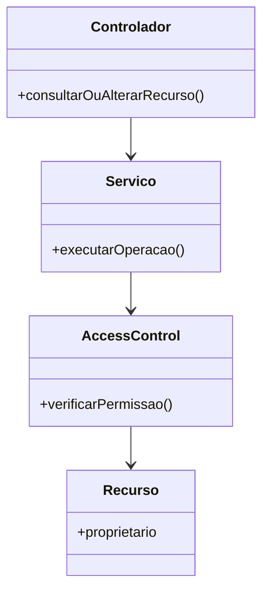

# Padrões de projeto aplicados

> **Artefato central da Sprint 5.** 

## 1. Problema recorrente identificado

A autorização de operações depende de verificar se o usuário autenticado tem permissão para acessar ou alterar determinado recurso. Quando essas verificações ficam distribuídas entre controladores e serviços, a mesma regra pode ser repetida ou aplicada de maneiras diferentes, aumentando o risco de inconsistência e dificultando a manutenção. No Conexão Solidária, a classe `AccessControl` é o ponto de centralização identificado para verificações de autorização relacionadas às propriedades dos recursos. A migração completa das verificações para esse ponto deve ser conferida no código antes de considerar o trabalho encerrado.

## 2. Padrão aplicado

### PP-01 — Fachada (Facade) para centralização das verificações de autorização

- **Problema que resolve:** reduz a dispersão das verificações de autorização e oferece um ponto de acesso comum para consultar se uma operação é permitida.
- **Contexto no projeto:** o backend precisa verificar permissões ao consultar ou modificar recursos. A classe `AccessControl` centraliza verificações de autorização baseadas nas propriedades dos recursos, evitando que cada parte da aplicação precise reimplementar toda a regra.
- **Participantes do padrão no código:** `AccessControl` como ponto central de verificação; controladores e serviços que solicitam a validação de autorização; modelos de domínio cujas propriedades são usadas para decidir o acesso. Os nomes exatos dos métodos chamadores devem ser conferidos na versão atual do repositório.
- **Requisitos relacionados:** requisitos funcionais de autenticação e autorização e requisitos não funcionais de segurança e manutenibilidade. Os identificadores `RF-XX` e `RNF-XX` não foram incluídos porque os códigos exatos dos requisitos não estão disponíveis no material consultado.
- **Issue/PR:** Issue #69 — PRJ-04, relacionada à migração/centralização da autorização. O status e o endereço da Issue/PR devem ser conferidos no GitHub antes da entrega.

## 3. Estrutura do padrão

## 4. Evidência no código

| Papel no padrão | Arquivo/classe/função | Link |
|---|---|---|
| Fachada/ponto central de autorização | `AccessControl` | Repositório Conexão Solidária — localizar `AccessControl` no backend |
| Cliente da verificação | Controladores e serviços que chamam `AccessControl` | Repositório Conexão Solidária — conferir os pontos de chamada |
| Recurso usado na decisão de acesso | Modelo de domínio e suas propriedades | Repositório Conexão Solidária — conferir os modelos envolvidos |

## 5. Alternativas e justificativa

| Alternativa | Vantagem | Limitação no contexto do projeto |
|---|---|---|
| Manter verificações de autorização distribuídas nos controladores e serviços | Implementação inicial simples e próxima de cada operação | Pode duplicar regras, produzir comportamentos inconsistentes e dificultar testes e manutenção |
| Centralizar as verificações em `AccessControl` (abordagem adotada) | Reúne a regra em um ponto identificável e facilita a reutilização e os testes | Exige que os controladores e serviços relevantes chamem o ponto central; verificações esquecidas continuam sendo um risco |
| Criar uma hierarquia extensa de políticas e classes de autorização | Pode separar regras complexas e permitir variações futuras | Acrescenta complexidade desnecessária se as regras atuais forem poucas e semelhantes |
| Não aplicar um padrão e corrigir cada ocorrência isoladamente | Menor mudança imediata | Mantém a regra dispersa e favorece regressões quando novas operações forem adicionadas |

## 6. Resultado observado

A centralização em `AccessControl` fornece um local único para localizar e revisar as verificações de autorização baseadas nas propriedades dos recursos. Isso favorece a reutilização e torna mais fácil testar as regras de acesso. O benefício completo depende de todos os controladores e serviços relevantes utilizarem esse ponto central e de haver testes cobrindo acessos permitidos e negados. Como a migração foi descrita como trabalho ainda em andamento na Issue #69 / PRJ-04, a cobertura integral e o resultado final precisam ser confirmados por revisão do código e execução dos testes; portanto, não se deve declarar a migração completa sem essa evidência.

## 7. Padrões avaliados e não aplicados

| Padrão | Por que não foi necessário ou adequado |
|---|---|
| Strategy | Não há evidência suficiente, no material consultado, de várias políticas intercambiáveis selecionadas em tempo de execução para justificar estratégias separadas. |
| Factory Method | Não foi identificado um problema concreto de criação de objetos que exija delegar a instanciação a subclasses ou métodos de fábrica. |
| Observer | Não foi identificado, neste problema de autorização, um fluxo de notificações a múltiplos observadores que justifique esse padrão. |
| Singleton | Não é necessário tornar `AccessControl` global por definição; a centralização da regra não exige, por si só, uma instância única global. |
