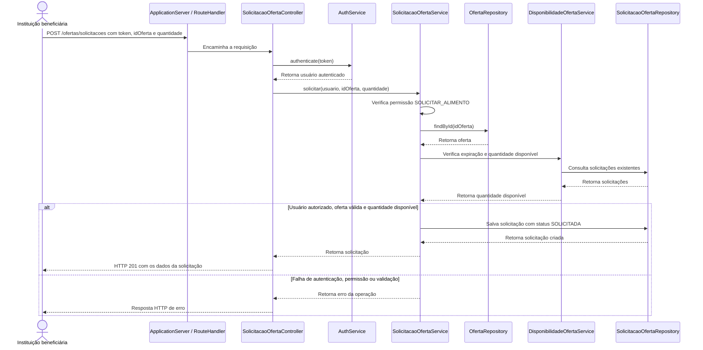
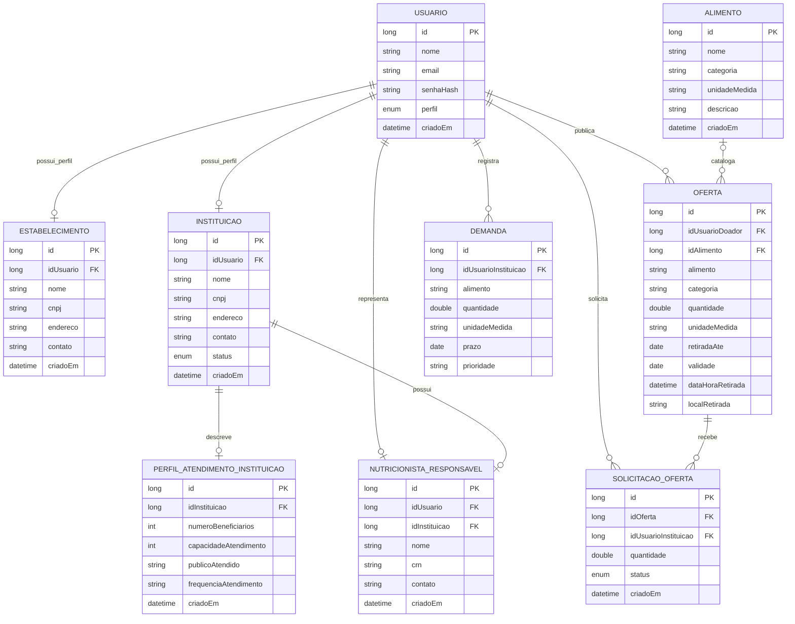

# Modelagem do sistema

> **Artefato central da Sprint 3.** Os modelos devem explicar a estrutura e o comportamento da solução e corresponder aos requisitos e ao código.

## 1. Modelos selecionados

| Modelo | Tipo | Pergunta que ele ajuda a responder | Requisitos relacionados |
|---|---|---|---|
| Solicitação de oferta | Comportamental | Como uma instituição autenticada solicita uma quantidade de uma oferta disponível? | RF-08, RF-10, RF-11, RF-12 e RF-13 |
| Domínio do Conexão Solidária | Estrutural | Quais classes de domínio existem e como seus identificadores se relacionam? | RF-01 a RF-23 |

## 2. Exemplo de modelo comportamental em Mermaid

**Descrição e decisões representadas:** O fluxo acompanha o endpoint de solicitação implementado no backend. O controller autentica o token, e o serviço verifica a permissão do perfil, se a oferta existe e não expirou, se a quantidade solicitada é positiva e se ainda há quantidade disponível. Quando aprovada, a solicitação é registrada com o estado `SOLICITADA`. A disponibilidade considera as solicitações nos estados `SOLICITADA` e `RETIRADA`; cancelamentos deixam de consumir quantidade.

Os repositórios atuais armazenam dados em memória, portanto o diagrama não inclui um banco de dados. O front-end ainda não está integrado a esse endpoint. A implementação também não verifica se a instituição está habilitada antes da solicitação, não oferece consulta ao histórico e não garante atomicidade entre a verificação de quantidade e o salvamento. Esses pontos são limitações atuais do código, embora existam requisitos relacionados a eles.

## 3. Exemplo de modelo estrutural em Mermaid

**Descrição e decisões representadas:** O diagrama corresponde às classes do pacote `model`. `USUARIO` contém o perfil de acesso. Estabelecimentos e instituições têm um usuário responsável; ofertas, demandas e solicitações também guardam o identificador do usuário que as criou. Uma solicitação referencia uma oferta e o usuário solicitante.

`OFERTA` possui `idAlimento` e também guarda nome e categoria como texto. Esse identificador pode ser zero quando a oferta não referencia um item do catálogo. `DEMANDA` armazena o nome do alimento como texto e não tem uma relação direta com `ALIMENTO`. As marcações `PK` e `FK` indicam identificadores e referências existentes nas classes; não representam restrições de um banco relacional, pois os repositórios são em memória.

## 4. Relação entre requisitos e modelos

| Requisito | Elemento do modelo | Como está representado | Alteração provocada no backlog/código |
|---|---|---|---|
| RF-01 e RF-02 | `ESTABELECIMENTO`, `INSTITUICAO` e `USUARIO` | Cadastro das entidades associadas ao usuário responsável. | Classes, serviços, controllers e repositórios existentes; persistência em banco não implementada. |
| RF-03 e RF-04 | `NUTRICIONISTA_RESPONSAVEL`, `INSTITUICAO.status` | O nutricionista é associado à instituição e esta possui status. | Cadastro de nutricionista e habilitação existem, mas o serviço de habilitação não verifica se há nutricionista vinculado, como exige RN-01. |
| RF-05 e RF-06 | `USUARIO.perfil`, `AuthService`, `AccessControl` | Autenticação e permissões são relacionadas ao perfil do usuário. | Autenticação e controle de acesso implementados; algumas verificações ainda estão nos controllers. |
| RF-07 a RF-09 | `OFERTA`, `ALIMENTO` e `OfertaFiltros` | Oferta contém alimento, quantidade, datas, local e filtros de consulta. | Cadastro, consulta e filtros existem no backend; o front-end ainda não chama a API. |
| RF-10 | `SOLICITACAO_OFERTA` e `SolicitacaoOfertaService` | Instituição solicita uma quantidade de uma oferta. | Solicitação implementada; a habilitação da instituição não é verificada no fluxo atual. |
| RF-11 | `OFERTA.quantidade` e solicitações | A quantidade disponível é calculada subtraindo solicitações `SOLICITADA` e `RETIRADA`. | Cálculo implementado; a atualização não é atômica em operações concorrentes. |
| RF-12 e RF-13 | `SOLICITACAO_OFERTA.status` | Estados `SOLICITADA`, `RETIRADA` e `CANCELADA`; retirada é confirmada pelo doador. | Solicitar, confirmar e cancelar implementados; consulta do histórico não está disponível. |
| RF-14 | Solicitações e ofertas do usuário | O histórico é representado como necessidade do domínio. | Consulta do histórico ainda não implementada. |
| RF-15 | `PERFIL_ATENDIMENTO_INSTITUICAO` | Registra beneficiários, capacidade, público e frequência. | Cadastro e consulta implementados com beneficiários, capacidade, público atendido e frequência; há divergência no vínculo de alguns dados às regras de demanda. |
| RF-16 a RF-19 | `DEMANDA` | Armazena alimento, quantidade, unidade, prazo e prioridade. | Cadastro básico implementado; finalidade, beneficiários estimados, consumo per capita, alertas e justificativa não estão completos no backend. |
| RF-20 | `DemandaService.listar` | Consulta as demandas cadastradas. | Consulta implementada no backend. |
| RF-21 | `OFERTA`, `DEMANDA` e `ALIMENTO` | O modelo contém dados para identificar alimento, quantidade e prazo. | Correspondência automática entre ofertas e demandas ainda não implementada. |
| RF-22 | `ALIMENTO` | Catálogo com nome, categoria e unidade de medida. | Cadastro e consulta do catálogo implementados no backend. |
| RF-23 | Estados de oferta e solicitação | Os estados registram parte dos eventos operacionais. | Sistema de notificações ainda não implementado. |

## 5. Correspondência entre modelo e código

| Elemento modelado | Arquivo/diretório correspondente | Observação |
|---|---|---|
| Servidor e rotas HTTP | [`ApplicationServer.java`](../BackEnd/src/main/java/conexaosolidaria/server/ApplicationServer.java), [`RouteHandler.java`](../BackEnd/src/main/java/conexaosolidaria/server/RouteHandler.java) | Recebem e encaminham requisições aos controllers. |
| Cadastro e autenticação de usuários | [`UsuarioController.java`](../BackEnd/src/main/java/conexaosolidaria/controller/UsuarioController.java), [`UsuarioService.java`](../BackEnd/src/main/java/conexaosolidaria/service/UsuarioService.java), [`AuthService.java`](../BackEnd/src/main/java/conexaosolidaria/service/AuthService.java) | Cadastro e autenticação implementados no backend. |
| Permissões | [`AccessControl.java`](../BackEnd/src/main/java/conexaosolidaria/security/AccessControl.java), [`Permissao.java`](../BackEnd/src/main/java/conexaosolidaria/model/Permissao.java) | Verifica permissões por perfil e propriedade. |
| Instituição e estabelecimento | [`Instituicao.java`](../BackEnd/src/main/java/conexaosolidaria/model/Instituicao.java), [`Estabelecimento.java`](../BackEnd/src/main/java/conexaosolidaria/model/Estabelecimento.java) | Modelos ligados ao usuário por `idUsuario`. |
| Perfil de atendimento e nutricionista | [`PerfilAtendimentoInstituicao.java`](../BackEnd/src/main/java/conexaosolidaria/model/PerfilAtendimentoInstituicao.java), [`NutricionistaResponsavel.java`](../BackEnd/src/main/java/conexaosolidaria/model/NutricionistaResponsavel.java) | Ambos são associados à instituição. |
| Alimento | [`Alimento.java`](../BackEnd/src/main/java/conexaosolidaria/model/Alimento.java), [`AlimentoService.java`](../BackEnd/src/main/java/conexaosolidaria/service/AlimentoService.java) | Catálogo de alimentos do backend. |
| Oferta e disponibilidade | [`Oferta.java`](../BackEnd/src/main/java/conexaosolidaria/model/Oferta.java), [`OfertaService.java`](../BackEnd/src/main/java/conexaosolidaria/service/OfertaService.java), [`DisponibilidadeOfertaService.java`](../BackEnd/src/main/java/conexaosolidaria/service/DisponibilidadeOfertaService.java) | Cadastro, consulta, filtros e cálculo da quantidade disponível. |
| Solicitação de oferta | [`SolicitacaoOferta.java`](../BackEnd/src/main/java/conexaosolidaria/model/SolicitacaoOferta.java), [`SolicitacaoOfertaController.java`](../BackEnd/src/main/java/conexaosolidaria/controller/SolicitacaoOfertaController.java), [`SolicitacaoOfertaService.java`](../BackEnd/src/main/java/conexaosolidaria/service/SolicitacaoOfertaService.java) | Solicitação, confirmação da retirada e cancelamento. |
| Demanda | [`Demanda.java`](../BackEnd/src/main/java/conexaosolidaria/model/Demanda.java), [`DemandaService.java`](../BackEnd/src/main/java/conexaosolidaria/service/DemandaService.java) | Cadastro e consulta básicos; campos adicionais dos requisitos ainda faltam. |
| Repositórios | [`repository/`](../BackEnd/src/main/java/conexaosolidaria/repository/) | Armazenam dados em memória; não há persistência relacional conectada. |
| Interface web | [`front-end/`](../front-end/) | Protótipo com HTML, CSS e JavaScript; ainda não integrado aos endpoints do backend. |

## 6. Refinamentos identificados

- A solicitação de oferta é uma entidade própria porque possui quantidade, estado e data de criação, além de relacionar usuário e oferta.
- A disponibilidade é calculada considerando as solicitações pendentes e as retiradas confirmadas; cancelamentos não reduzem a quantidade disponível.
- Estabelecimento e instituição são cadastros associados a um usuário, enquanto os perfis de acesso ficam no atributo `USUARIO.perfil`.
- Oferta pode referenciar um alimento do catálogo, mas também mantém os dados textuais do alimento. Demanda não possui referência direta ao catálogo.
- A modelagem mostra referências por identificadores, mas não pressupõe banco de dados ou chaves estrangeiras físicas.
- Os diagramas descrevem o backend existente. A integração do front-end, a consulta de histórico, as notificações e a correspondência entre ofertas e demandas permanecem pendentes.

## 7. Histórico de atualização

| Sprint | Modelo alterado | Motivo | Evidência |
|---|---|---|---|
| Sprint 3 | Modelo comportamental e estrutural | Registrar o fluxo de solicitação e as entidades principais do domínio. | [`modelagem.md`](modelagem.md) |
| Sprint 4 | Correspondência entre modelo e código | Atualizar o modelo após a implementação dos serviços de disponibilidade e solicitação de oferta. | [`decisoes-de-projeto.md`](../docs/projeto/decisoes-de-projeto.md) |
